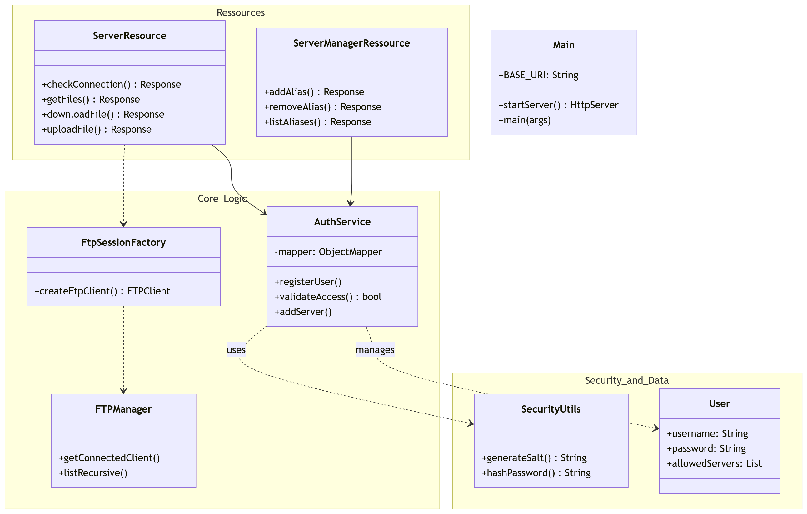
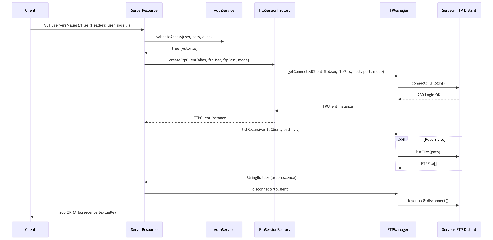
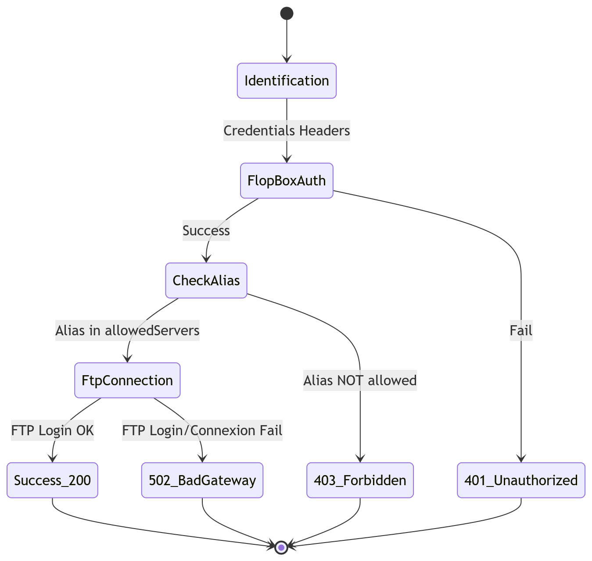
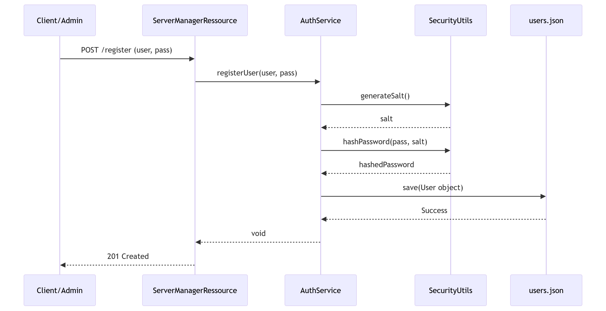
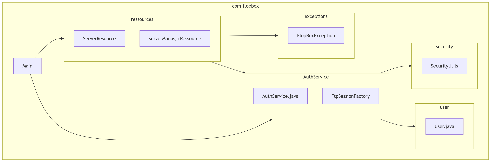

# FlopBox : Passerelle API REST pour Serveurs FTP


## Introduction

Ce logiciel, nommé FlopBox, est une passerelle (proxy) REST permettant d'interagir avec des serveurs FTP distants via des requêtes HTTP. L'objectif est d'abstraire la complexité du protocole FTP (gestion des modes actif/passif, état de la connexion) pour offrir une interface simple aux développeurs web. Le système intègre sa propre gestion d'utilisateurs avec un stockage JSON sécurisé par hachage salé (SHA-256), permettant de restreindre l'accès à certains serveurs FTP par utilisateur.

## Instructions de build et d'exécution

Le projet utilise l'outil Apache Maven pour la gestion des dépendances et la génération de l'artefact.
Prérequis 
- Java 17 ou supérieur
- Maven 3.6+
- Un serveur FTP local pour les tests (ex: pyftpdlib)

### Commandes

Le projet utilise un serveur python local `Server.py`, pour le lancer placez vous dans le dossier FlopBox et executez la commande : 

`````bash
python src/main/java/server/Server.py

`````

Vous pouvez utiliser un serveur FTP de test via Python par la ligne de commande suivante : 

````bash
python -m pyftpdlib -p 2121 -u "bouchra" -P "12345" -w
 ````

#### Empaqueter le projet

Pour générer le JAR exécutable contenant toutes les dépendances :

````bash
mvn clean package
````
Le fichier JAR généré se trouve dans target/FlopBox-1.0-SNAPSHOT-jar-with-dependencies.jar

- Pour exécuter le jar : 
````bash
java -jar target/FlopBox-1.0-SNAPSHOT-jar-with-dependencies.jar
````

Le serveur sera accessible sur ``http://localhost:8080``.

#### Tests et Documentation

- Lancer les tests : 
````bash
mvn test
````

- Générer la Javadoc : 
````
mvn javadoc:javadoc
````

## Architecture

L'architecture repose sur une séparation nette entre l'interface REST et la logique de communication FTP.
- Séparation des responsibilitées : ``ServerManagementRessource`` gére la création, ajout et suppression d'un serveur pour un utilisateur, et ``ServerRessource`` gére la connexion et les autres fonctionnalités du flopBox.
- Services : AuthService gère la persistance des utilisateurs dans users.json. Il utilise SecurityUtils pour le traitement cryptographique. 
- Polymorphisme : La gestion des exceptions utilise le polymorphisme. La classe abstraite FlopBoxException est étendue par des exceptions spécifiques (404, 401, 409), permettant une capture générique et une conversion automatique en codes de statut HTTP.
- Design Pattern Factory : Utilisé pour instancier les clients FTP en fonction de la configuration (hôte, port, mode). FtpSessionFactory définit le contrat pour la création de sessions, permettant de simuler (mocker) la connexion FTP lors des tests.
- Gestion dynamique des flux de données : L'application délègue la configuration du canal de données à une FtpSessionFactory. Celle-ci interprète le header HTTP ftp-mode pour basculer le client Apache Commons Net soit en enterLocalPassiveMode(), soit en enterLocalActiveMode() (mode standard). Cette abstraction permet de supporter n'importe quelle configuration réseau sans modifier la logique métier des ressources.
### Gestion d'erreurs
- *Détection* : Utilisation systématique de throw new XException() dès qu'une règle métier est violée (ex: UnauthorizedException si les identifiants FlopBox sont erronés).
- *Résolution* : Les ressources JAX-RS utilisent des blocs catch pour intercepter les exceptions métier et renvoyer une réponse Response.status(X).build() appropriée au client, évitant ainsi tout crash du serveur.

## Code Samples
1. Hachage sécurisé (Sécurité)

Le système ne stocke jamais de mots de passe en clair. Un sel aléatoire est généré pour chaque utilisateur.

````java
public static String hashPassword(String password, String salt) {
  // Le sel est concaténé au mot de passe avant le hachage SHA-256
  MessageDigest md = MessageDigest.getInstance("SHA-256");
  md.update(Base64.getDecoder().decode(salt));
  byte[] hashedPassword = md.digest(password.getBytes());
  return Base64.getEncoder().encodeToString(hashedPassword);
} public static String hashPassword(String password, String salt) {
    try {
        MessageDigest digest = MessageDigest.getInstance("SHA-256");
        String combined = password + salt;
        byte[] hash = digest.digest(combined.getBytes(StandardCharsets.UTF_8));

        StringBuilder hexString = new StringBuilder();
        for (byte b : hash) {
            String hex = Integer.toHexString(0xff & b);
            if (hex.length() == 1) hexString.append('0');
            hexString.append(hex);
        }
        return hexString.toString();
    } catch (Exception e) {
        throw new RuntimeException(e);
    }
}
````

2. Pattern Factory pour la session FTP (Design Pattern)

L'abstraction de la création de session permet de découpler la ressource REST de la bibliothèque Apache Commons Net.
````java
public static FTPClient createFtpClient(String alias, String fU, String fP, String mode) throws FlopBoxException {
        try {
            String host = alias.contains(":") ? alias.split(":")[0] : alias;
            int port = alias.contains(":") ? Integer.parseInt(alias.split(":")[1].trim()) : 2121;

            boolean isPassive = !(mode != null && mode.equalsIgnoreCase("active"));

            return FTPManager.getConnectedClient(fU, fP, host, port, isPassive);
        } catch (IOException e) {
            throw new FtpConnectionException("Erreur de connexion au serveur FTP : " + e.getMessage());
        }
    }
````

3. Gestion de l'étanchéité des exceptions (Gestion d'erreurs)

Les erreurs FTP sont encapsulées dans des exceptions personnalisées pour ne pas exposer la stacktrace technique.
````java
try {
  return ftpClient.listFiles(path);
} catch (IOException e) {
  // L'exception technique est transformée en exception métier
  throw new FtpOperationException("Erreur lors du listing : " + e.getMessage());
}
````
4. Injection de dépendances (Architecture)

L'utilisation de @Inject permet de remplacer le service réel par un Mock lors des tests unitaires.
````Java

@Path("/manage-servers")
public class ServerManagerRessource {
@Inject
private AuthService authService; // Injecté par Jersey (HK2) ou Mockito
...
}
````

5. Streaming de fichiers (Optimisation)

Le téléchargement de fichiers utilise un flux de sortie pour supporter les fichiers volumineux sans saturer la RAM.
````Java

StreamingOutput fileStream = output -> {
// Le flux est écrit directement de la socket FTP vers la socket HTTP
ftpClient.retrieveFile(remotePath, output);
ftpClient.disconnect();
};
return Response.ok(fileStream).build();
````

6. Gestion du mode de connexion (Actif/Passif)

Le serveur adapte sa stratégie réseau dynamiquement en fonction des métadonnées de la requête HTTP.
````Java
// Extrait de FtpSessionFactory.java
// On définit le mode par défaut en passif (plus robuste)
boolean isPassive = !(mode != null && mode.equalsIgnoreCase("active"));

if (isPassive) {
ftpClient.enterLocalPassiveMode(); // Le serveur FTP ouvre un port éphémère
} else {
ftpClient.enterLocalActiveMode();  // Le client ouvre un port et le serveur s'y connecte
}
````

## Exemples d'utilisation (API)

- Pour vérifier la connection en mode active :
````bash
curl.exe -X GET http://localhost:8080/servers/localhost:2121 -H "user: bouchra" -H "password: bouchra" -H "ftp-user: bouchra" -H "ftp-pass: 12345" -H "ftp-mode: active" 
````

- Pour afficher l'arborescence :
````bash
curl.exe -X GET http://localhost:8080/servers/localhost:2121/files -H "user: bouchra" -H "password: bouchra" -H "ftp-user: bouchra" -H "ftp-pass: 12345" -H "ftp-mode: active" 
````

- Pour faire download du fichier todo.txt vers output.txt :
    - En mode active :
````bash
curl.exe -X GET http://localhost:8080/servers/localhost:2121/files/todo.txt -H "user: bouchra" -H "password: bouchra" -H "ftp-user: bouchra" -H "ftp-pass: 12345" -H "ftp-mode: active" --output FTP_DATA/out/output.txt
```` 

- En mode passive :
````bash
curl.exe -X GET http://localhost:8080/servers/localhost:2121/files/todo.txt -H "user: bouchra" -H "password: bouchra" -H "ftp-user: bouchra" -H "ftp-pass: 12345" -H "ftp-mode: passive" --output FTP_DATA/out/output.txt
````

Pour un video :
````bash
 curl.exe -X GET "http://localhost:8080/servers/localhost:2121/files/video.mp4" -H "user: bouchra" -H "password: bouchra" -H "ftp-user: bouchra" -H "ftp-pass: 12345" -H "ftp-mode: active"  --output FTP_DATA/out/video_out.mp4
````

Pour un pdf :
````bash
curl.exe -X GET "http://localhost:8080/servers/localhost:2121/files/Notes.pdf" -H "user: bouchra" -H "password: bouchra" -H "ftp-user: bouchra" -H "ftp-pass: 12345" -H "ftp-mode: active"  --output FTP_DATA/out/Note.pdf     
````

Pour une image :
````bash
curl.exe -X GET "http://localhost:8080/servers/localhost:2121/files/siteweb.png" -H "user: bouchra" -H "password: bouchra" -H "ftp-user: bouchra" -H "ftp-pass: 12345" -H "ftp-mode: active"  --output FTP_DATA/out/siteweb.png     
````

- Pour faire upload :

1. On met notre fichier dans le dossier racine FlopBox
2. on trouve le fichier téléversé dans le dossier FTP_DATA

Pour un fichier txt :
````bash
curl.exe -X POST http://localhost:8080/servers/localhost:2121/files/todo.txt -H "user: bouchra" -H "password: bouchra" -H "ftp-user: bouchra" -H "ftp-pass: 12345" -H "ftp-mode: active" -F "file=@todo.txt"
````
Pour un video :
````bash
curl.exe -X POST http://localhost:8080/servers/localhost:2121/files/video.mp4 -H "user: bouchra" -H "password: bouchra" -H "ftp-user: bouchra" -H "ftp-pass: 12345" -H "ftp-mode: active" -F "file=@video.mp4"
````

- Pour ajouter un nouvel utilisateur à la plateforme :
````bash
curl.exe -i -X POST "http://localhost:8080/manage-servers/register" -H "new-user: bob" -H "new-password: bob"
````

- Pour ajouter un nouveau serveur :
````bash
curl.exe -X POST "http://localhost:8080/manage-servers/127.0.0.1:2121" -H "user: bob" -H "password: bob"                     
````

- Pour supprimer un serveur d'un utilisateur :
````bash
curl.exe -X DELETE "http://localhost:8080/manage-servers/127.0.0.1:2121" -H "user: bob" -H "password: bob"         
````

- Pour modifier un serveur déja enregistré pour un utilisateur :
````bash
curl.exe -X PUT "http://localhost:8080/manage-servers/127.0.0.1:2121?new=127.0.0.1:21" -H "user: alice" -H "password: alice"
````
- Pour créer une ressource sur le serveur FTP :

- Un dossier :
````bash
curl.exe -i -X POST "http://localhost:8080/servers/localhost:2121/directory/VACANCES" -H "user: bouchra" -H "password: bouchra" -H "ftp-user: bouchra" -H "ftp-pass: 12345"
````

- Renommer "video.mp4" en "film.mp4" :
````bash
curl.exe -i -X PUT "http://localhost:8080/servers/localhost:2121/files/video.mp4?new=film.mp4" -H "user: bouchra" -H "password: bouchra" -H "ftp-user: bouchra" -H "ftp-pass: 12345"
````

- Supprimer un fichier :
````bash
curl.exe -i -X DELETE "http://localhost:8080/servers/localhost:2121/files/Note.pdf" -H "user: bouchra" -H "password: bouchra" -H "ftp-user: bouchra" -H "ftp-pass: 12345"
````

- Rechercher dans les serveurs :
`````bash
curl.exe -X GET "http://localhost:8080/servers/search?name=bouchra" -H "user: bouchra" -H "password: bouchra" -H "ftp-user: bouchra" -H "ftp-pass: 12345"
`````

## Documentation d'architecture (UML)

Le dossier doc/ contient les modélisations suivantes :

1. Diagramme de Classes (Architecture Complète)

Ce diagramme inclut désormais la couche de sécurité, la gestion des utilisateurs et la séparation des ressources REST.


2. Diagramme de Séquence (Listing de fichiers)

Ce diagramme illustre le flux d'une requête type (le "Proxy" entre le client REST et le serveur FTP distant).


3. Diagramme d'État (Authentification & Autorisation)

Il montre la double vérification qu'on a mis en place.


2. Diagramme de Séquence : Inscription et Sécurité

Voici comment les données transitent lors de la création d'un utilisateur, en utilisant SecurityUtils.


3. Diagramme de Paquetages (Package Diagram)

Pour visualiser la dépendance entre tes dossiers dans src/main/java.

