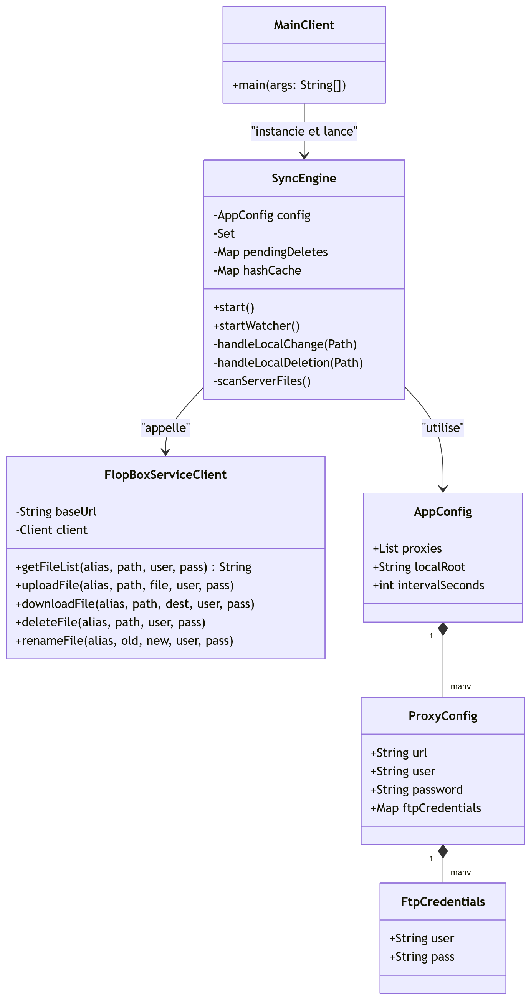
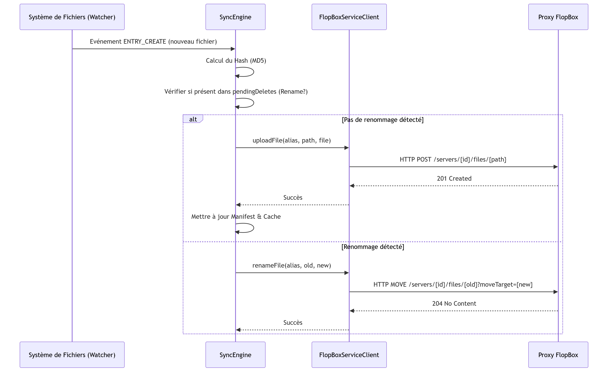
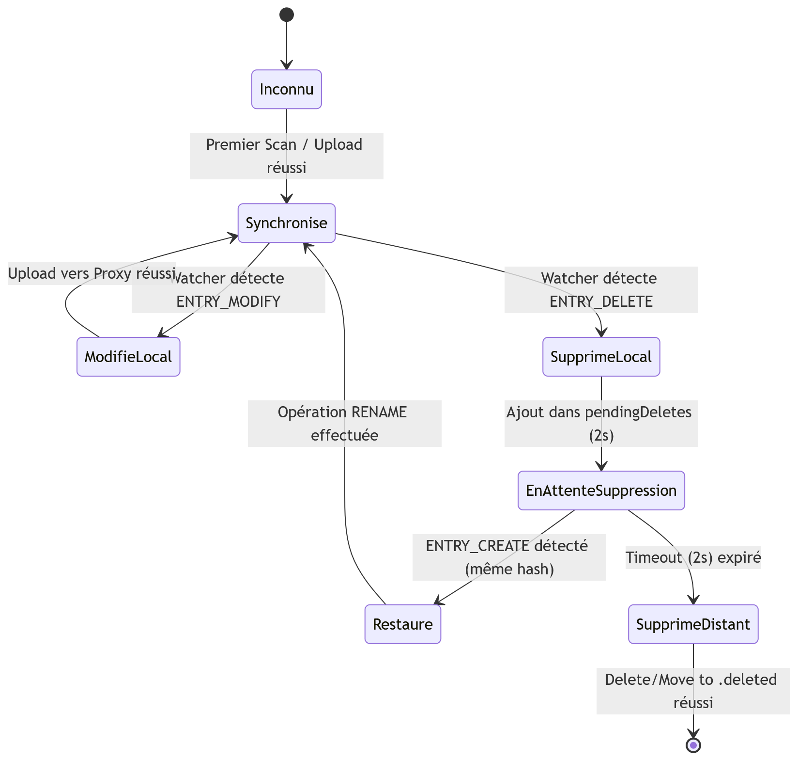
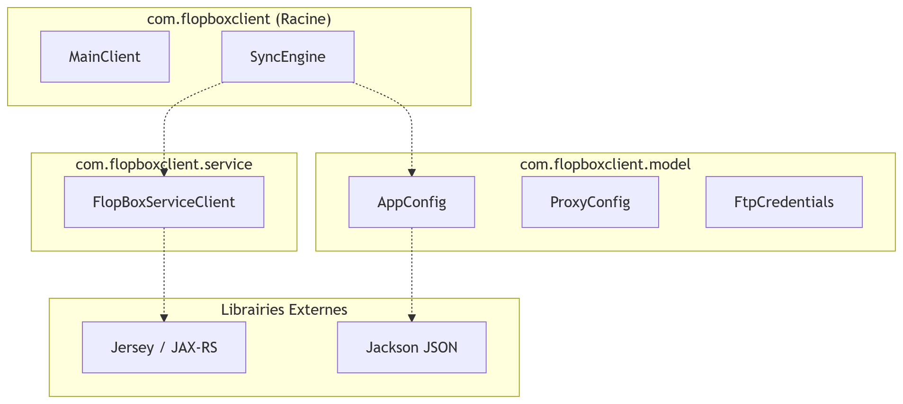

# FlopBoxClient

## Introduction

FlopBoxClient est une application Java robuste conçue pour la synchronisation automatique et bidirectionnelle entre un système de fichiers local et plusieurs serveurs FTP distants via l'API Proxy FlopBox.
S'inspirant du fonctionnement de services comme Dropbox, ce client surveille les modifications locales en temps réel (création, modification, renommage, suppression) et les répercute sur le serveur. Il inclut également un système de corbeille permettant de restaurer des fichiers supprimés par erreur grâce à un encodage des chemins dans le dossier `.deleted`.

## Instructions de build et d'exécution

Le projet utilise l'outil Apache Maven pour la gestion des dépendances et la génération de l'artefact.
### Prérequis
- Java 17 ou supérieur
- Maven 3.6+
- Un serveur FTP local pour les tests (ex: pyftpdlib)

### Commandes de Build
- Empaqueter le projet

Pour générer le JAR exécutable contenant toutes les dépendances :
````
mvn clean package
````

Le fichier JAR généré se trouve dans : target/FlopBoxClient-1.0-SNAPSHOT.jar

- Exécution via JAR
````
java -jar target/FlopBoxClient-1.0-SNAPSHOT.jar
````

## Commandes

1. Lancer les serveurs FTP de test

Pour tester la synchronisation multi-serveurs, lancez deux instances FTP dans des dossiers différents :

- Serveur 1 (Port 2121) : Dans le dossier server1
````bash
python -m pyftpdlib -p 2121 -u "bouchra" -P "12345" -w
````

- Serveur 2 (Port 2222) : Dans le dossier server2
````bash
python -m pyftpdlib -p 2222 -u "bouchra" -P "12345" -w
````

2. Lancer le serveur Proxy FlopBox

Dans le dossier racine FlopBox :
````bash
mvn exec:java
````
Le serveur sera accessible sur http://localhost:8080.

3. Lancer le Client de Synchronisation

Dans le dossier FlopBoxClient :
````bash
mvn exec:java
````

4. Commandes de gestion de la Corbeille

Une fois le client lancé, vous accédez à une console interactive pour gérer les fichiers supprimés :
- list-deleted : Affiche les fichiers présents dans la corbeille distante.
- restore <alias> <nom_fichier> : Restaure un fichier vers son emplacement d'origine.
- purge : Vide définitivement la corbeille sur les serveurs.
- exit : Quitte l'application.

Exemple de restauration :
````Bash
restore localhost:2121 film.mp4
````

## Tests et Documentation

Lancer les tests :
````
mvn test
````
Générer la Javadoc :
````
mvn javadoc:javadoc
````

## Architecture

L'architecture repose sur une séparation nette entre l'interface REST et la logique de communication FTP.

- **Moteur de Synchronisation (SyncEngine)** : Utilise l'API WatchService de Java pour surveiller les événements du système de fichiers local.
- **Gestion du Renommage** : Implémente une logique de détection de mouvement basée sur le hachage (MD5) pour transformer une paire "Suppression + Création" en une seule commande MOVE sur le serveur.
- **Client REST (FlopBoxServiceClient)** : Utilise Jersey avec le connecteur Apache pour supporter les méthodes HTTP personnalisées.
- **Sécurité** : Gestion de l'authentification double (Proxy et FTP) via des headers HTTP personnalisés.

## Code Samples
1. Hachage sécurisé (Vérification d'intégrité)

Utilisé pour comparer les fichiers locaux et distants sans transfert inutile de données.
````java
public String computeHash(File file) {
        try {
            java.security.MessageDigest md = java.security.MessageDigest.getInstance("MD5");
            try (java.io.InputStream is = Files.newInputStream(file.toPath())) {
                byte[] buf = new byte[8192];
                int n;
                while ((n = is.read(buf)) != -1) md.update(buf, 0, n);
            }
            StringBuilder sb = new StringBuilder();
            for (byte b : md.digest()) sb.append(String.format("%02x", b));
            return sb.toString();
        } catch (Exception e) {
            return null;
        }
    }
````
2. Gestion du renommage distant (Verbe MOVE)

Utilisation d'un verbe HTTP personnalisé pour optimiser les performances.

````java
public void renameFile(String alias, String oldPath, String newPath, String ftpUser, String ftpPass) throws Exception {
        Response response = client.target(baseUrl)
                .path("servers")
                .path(alias)
                .path("files")
                .path(oldPath)
                .queryParam("moveTarget", newPath)
                .request()
                .header("user", user)
                .header("password", password)
                .header("ftp-user", ftpUser)
                .header("ftp-pass", ftpPass)
                .build("MOVE", null)
                .invoke();

        if (response.getStatus() != 200 && response.getStatus() != 204) {
            throw new Exception("Erreur renommage: " + response.getStatus());
        }
    }
````

## Documentation d'architecture (UML)
Le dossier doc/ contient les modélisations suivantes :

1. Diagramme de Classes (Architecture Complète)

Ce diagramme montre la relation entre le moteur de synchronisation, les modèles de données et le client de service REST.



2. Diagramme de Séquence

Ce diagramme illustre le processus de détection d'un changement local et son impact sur le serveur distant.



3. Diagramme d'État

Ce diagramme suit les différents états par lesquels passe un fichier surveillé par le moteur.



4. Diagramme de Paquetages

Ce diagramme montre l'organisation logique du code et les dépendances entre les différents packages.



