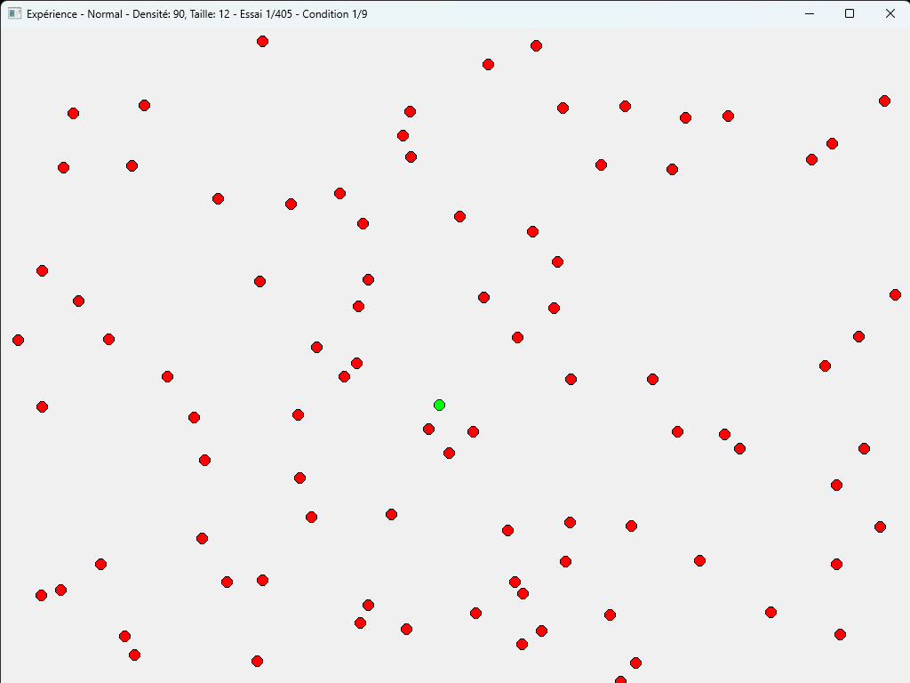
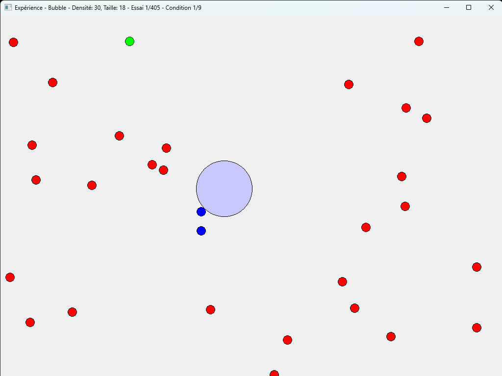
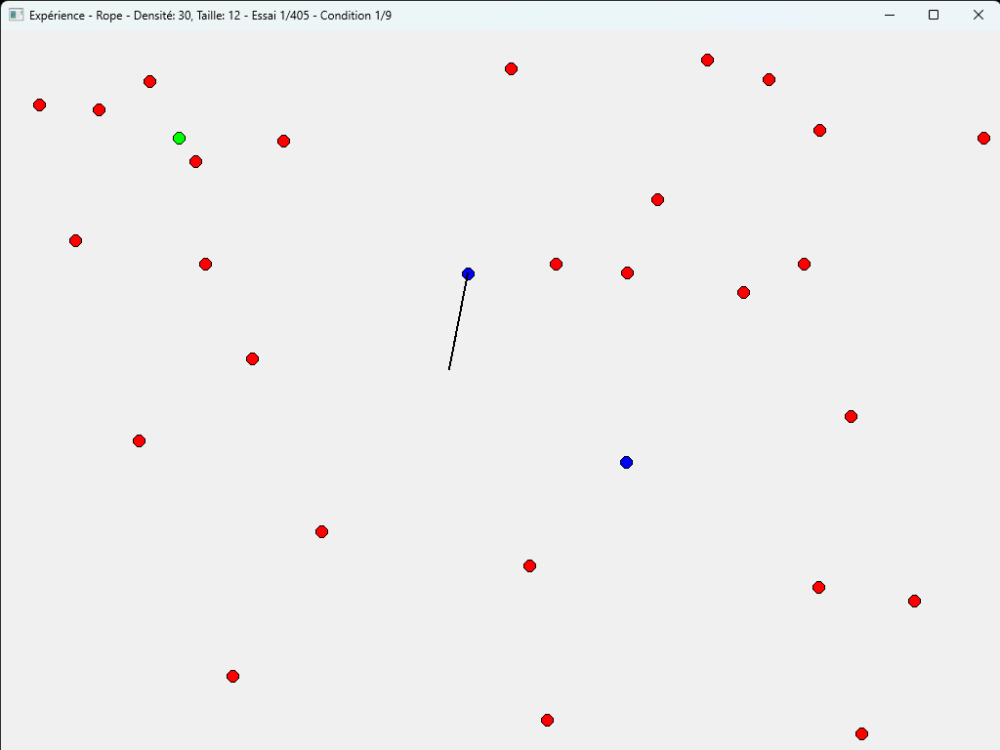

# 🖱️ Controlled Experiment & Advanced Cursors (HCI / IHMA)

An experimental framework and research tool developed for Human-Computer Interaction (Interaction Homme-Machine - IIHM) studies. This project implements and evaluates different target-acquisition cursor techniques (Normal, Bubble, and Rope cursors) through automated, rigorous controlled experiments.

## 🚀 Key Features

* **Advanced Cursor Techniques**: 
  * **Normal Cursor**: Standard point-and-click pointer implementation as a baseline.

  

  * **Bubble Cursor**: Area-cursor technique that dynamically resizes based on the distance to the closest target to facilitate selection (Fitts's Law optimization).

  

  * **Rope Cursor**: Specialized trajectory-based or anchored selection mechanism.

  

* **Controlled Experiment Framework (`experience/`)**:
  * Automated experiment setup and configuration (`ExpSetup.py`).
  * Target generation algorithms for reproducible layouts (`generate_targets.py`).
  * Session and participant lifecycle management via an experiment manager (`XPManager.py`).
  * Real-time logging of user performance, movement trajectories, errors, and task completion times (`logs/`).

## 🛠️ Tech Stack

* **Language**: Python 3.x
* **GUI / Graphics**: Pygame or Processing-equivalent Python framework for real-time rendering and interaction handling.
* **Architecture**: Modular object-oriented design separating cursor mechanics, widget targets, and experiment orchestration.

## 📁 Project Structure

```
experience/
│
├── cursors/                # Cursor techniques & widget implementations
│   ├── BubbleCursor.py     # Bubble cursor logic
│   ├── BubbleWidget.py     # Interactive targets for bubble cursor
│   ├── NormalCursor.py     # Standard pointer logic
│   ├── NormalWidget.py     # Standard targets
│   ├── RopeCursor.py       # Rope cursor implementation
│   ├── RopeWidget.py       # Rope cursor targets
│   ├── Target.py           # Base target class
│   └── MainBubble.py       # Execution entry point for cursor module
│
├── exps/                   # Experimental configurations and data batches
├── logs/                   # Raw participant performance logs and metrics
│
├── ExpSetup.py             # Experiment parameters and configuration setup
├── generate_targets.py     # Script to generate randomized/structured target layouts
├── MainExp.py              # Main entry point to run the controlled experiment workflow
└── XPManager.py            # Orchestrates blocks, trials, conditions, and data logging
```

## ⚙️ Getting Started

### Prerequisites

Ensure you have Python 3.8+ installed along with required graphical and mathematical libraries.

### Execution

1. Clone or navigate to the repository folder.
2. Run the main experiment orchestrator:
   ```bash
   python MainExp.py
   ```
3. To test specific cursor techniques independently:
   ```bash
   python cursors/MainBubble.py
   ```
4. To generate the targets :
    ```bash
    python generate_targets.py <number_of_targets> <size_of_targets> <space_between_targets>
    ```
