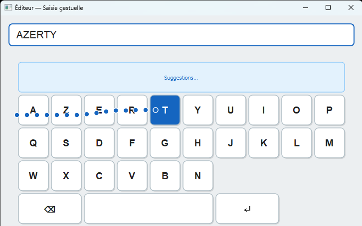

# ⌨️ Virtual Keyboard & Text Entry Evaluation (HCI / IHMA)

An experimental framework and implementation for evaluating virtual keyboard layouts, text entry performance, and predictive text algorithms developed as part of Human-Computer Interaction (Interaction Homme-Machine - IIHM) coursework.



## 🚀 Key Features

* **Virtual Keyboard Interface (`src/`)**: 
  * Interactive on-screen keyboard layout implementation.
  * Real-time typing mechanics and event handling.
* **Lexicon & Predictive Processing (`mots.txt`, `json/`)**:
  * Comprehensive French dictionary dataset (`mots.txt`) for word completion and frequency analysis.
  * JSON-based configuration files for layout parameters, dictionaries, or user profiles (`json/`).
* **Performance Metrics & Evaluation**:
  * Tracks Words Per Minute (WPM), character error rate (CER), and keystroke-level dynamics.

## 🛠️ Tech Stack

* **Language**: Python or Processing (depending on the core implementation framework).
* **Data Management**: Structured JSON configurations and text-based lexicon parsing.

## 📁 Project Structure

```
keyboard/
│
├── json/                   # Configuration files, layouts, and data caches
├── src/                    # Core source code (Keyboard UI, event listeners, logic)
│
├── mots.txt                # French lexicon dataset for text entry and prediction
└── README.md               # Project documentation
```

## ⚙️ Getting Started

### Prerequisites

Ensure you have the required runtime environment installed (Python / Processing framework).

### Execution

1. Clone or navigate to the repository folder.
2. Run the main entry point to launch the virtual keyboard interface.
  ```
  python src/Main.py
  ```
