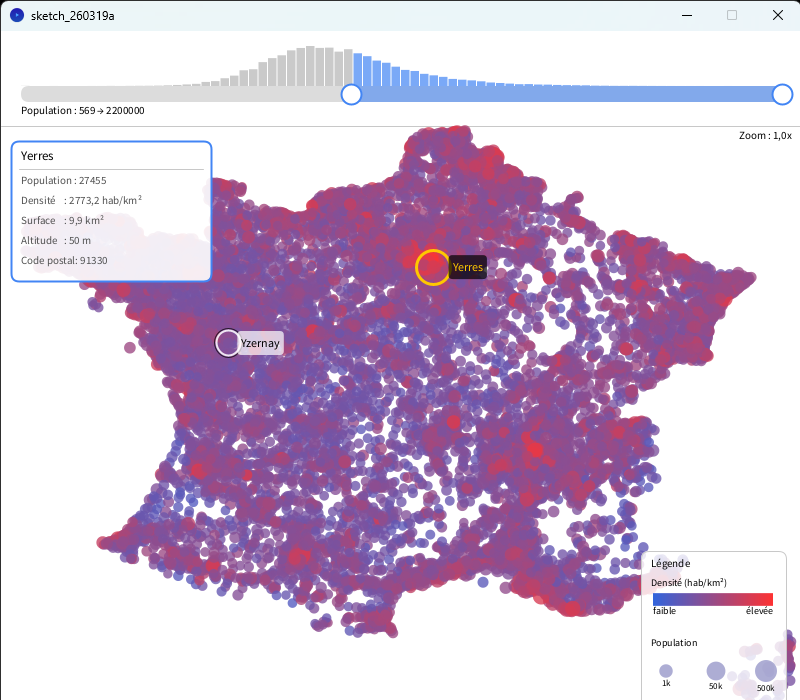

# Advanced HCI - Data Visualization & Interaction: French Cities

This project is an information visualization and interactive mapping application developed in **Processing (Java)**. It allows users to load, visualize, filter, and dynamically explore demographic and geographical data of French cities in an interactive manner.



---

##  Features

### 1. **Data-to-Graphic Visualization**
* **Cartographic Projection**: Mapping raw spatial coordinates ($x, y$) directly onto the screen coordinate space.
* **Visual Encoding by Density**: Color gradient (from blue for low density to red for high density) computed on a logarithmic scale.
* **Visual Encoding by Population**: Radius size of city markers (between 2px and 12px) mapped on a logarithmic scale.

### 2. **Map Navigation (Pan & Zoom)**
* **Centered Zoom**: Smooth zoom in/out using the mouse wheel (`mouseWheel`), centered precisely on the cursor location.
* **Pan (Dragging)**: Drag the map around by holding down the **right mouse button**.
* **Reset View**: Press the `R` or `r` key to reset the map position and zoom scale back to default.

### 3. **Interactive Population Filtering (Range Slider & Histogram)**
* **Dual-Handle Range Slider**: Two interactive handles allowing users to define minimum and maximum population thresholds (`minPopulationToDisplay` and `maxPopulationToDisplay`).
* **Distribution Histogram**: Dynamic rendering of 80 bins showing the distribution of cities across logarithmic population ranges.
  * **Blue bars**: Cities included within the active filter range.
  * **Gray bars**: Cities excluded by the filter.
* **Keyboard Shortcuts**:
  * `+` / `=`: Doubles the minimum population threshold.
  * `-`: Halves the minimum population threshold.
  * `*`: Doubles the maximum population threshold.
  * `/`: Halves the maximum population threshold.

### 4. **Geometric Selection & Detailed View (Picking & HUD)**
* **Hover Effect (Highlighting)**: Hovering over a city highlights it with an accentuated outline and displays a dynamic name label.
* **Overlap Management**: The `pick()` method prioritizes the city rendered on top (traversed in reverse draw order).
* **Click Selection (Pin/Lock)**:
  * Left-clicking on a city locks its selection, displaying a distinct yellow ring around it.
  * Displays a fixed **Information Panel** detailing all attributes of the selected city (Name, Population, Density, Area, Altitude, Zip Code).

### 5. **Legend & Heads-Up Display (HUD)**
* Fixed legend explaining the color scale for density ($hab/km^2$) and sample circles for population ranges.
* Real-time zoom level indicator ($x1.0, x2.5$, etc.).

---

## 📁 Project Structure

```text
.
├── VillesVisualisation.pde    # Main Processing sketch (setup, draw, event handlers)
├── City.pde                   # City data class, rendering logic, and picking
└── data/
    └── villes.tsv             # Tab-separated dataset of French cities
```

### Main Files Description:

* **`City.pde`**: 
  * Encapsulates the attributes of each municipality.
  * Computes density and circle radius dynamically.
  * Contains the `draw()` method to handle rendering and visual states (hover/selected).
  * Implements `contains(px, py)` for mouse-pointer hit detection.
  
* **`VillesVisualisation.pde`**:
  * Parses `villes.tsv` inside `readData()`.
  * Manages matrix transformations (`pushMatrix`, `translate`, `scale`).
  * Runs the main animation loop (`draw()`), mouse listeners (`mouseMoved`, `mousePressed`, `mouseDragged`, `mouseWheel`), and keyboard inputs (`keyPressed`).

---

## 🛠️ Requirements & Setup

1. Download and install **[Processing 3 or 4](https://processing.org/download)**.
2. Clone or download this repository.
3. Ensure the `villes.tsv` dataset is placed inside the `data/` folder of your Processing sketch.
4. Open the `.pde` file in the Processing IDE and click **Run** (▶ button).

---

## ⌨️ Controls Guide

| Action / Key | Function |
| :--- | :--- |
| **Mouse Wheel** | Zoom in / Zoom out centered on the cursor |
| **Right Click + Drag** | Pan across the map |
| **Left Click on a City** | Select / Deselect a city (displays detailed info panel) |
| **Drag Slider Handles** | Filter the displayed population range |
| **`R` Key** | Reset zoom and map position |
| **`+` / `-` Keys** | Double / Halve the minimum population threshold |
| **`*` / `/` Keys** | Double / Halve the maximum population threshold |

---

## 📊 Data Format (`villes.tsv`)

The file starts with a metadata line containing extreme bounds (`minX, maxX, minY, maxY, minPopulation...`), followed by tab-separated city records:

```text
PostalCode   X   Y   ...   Name   Population   Surface   Altitude
```

---

##  Authors

* **Development**: Project built for the Advanced HCI / Data Visualization lab (IHMA).
