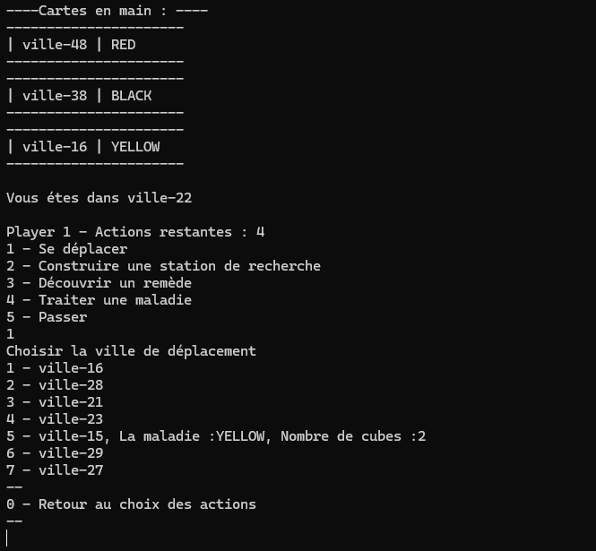

# PandemicGame — Jeu coopératif de lutte contre les maladies

Projet universitaire réalisé en équipe : une adaptation en Java, jouable dans
le terminal, d’un jeu coopératif de gestion d’épidémies. Les joueurs se
déplacent entre les villes, traitent les maladies, construisent des stations de
recherche et tentent de découvrir les quatre remèdes avant que l’épidémie ne
devienne incontrôlable.

Le plateau est chargé depuis [ville.json](ville.json), qui décrit les villes
et leurs voisines.




## Fonctionnalités

- Chargement de la carte et des liens entre villes depuis un fichier JSON.
- Partie pour deux à quatre joueurs avec rôles spécialisés : Scientifique,
  Globetrotter, Expert et Médecin.
- Mise en place de la partie avec ville de départ, stations de recherche,
  cartes joueur, cartes infection et cubes maladie.
- Quatre actions par joueur et par tour : se déplacer, construire une station,
  découvrir un remède, traiter une maladie ou passer.
- Pioches de cartes joueur et phases d’infection, avec cartes Épidémie,
  foyers et propagation vers les villes voisines.
- Conditions de victoire lorsque les quatre remèdes sont découverts et de
  défaite si la réserve de cubes ou la pile de cartes joueur s’épuise, ou si le
  nombre maximal de foyers est atteint.

## Technologies et conception

- **Java** pour le modèle des villes, joueurs, cartes, maladies, actions et
  déroulement de partie.
- **JSON-java** (`zombicide.jar`), fourni dans `src/`, pour charger les
  villes et leurs voisines.
- **JUnit 4** pour les tests unitaires présents dans `test/`.

Les responsabilités sont réparties entre les packages `city`, `map`,
`player`, `role` (implémenté sous le package `action`), `card`, `pile`,
`infection` et `game`.


## Prérequis

- JDK avec `javac` et `java`, ainsi que GNU Make.
- Sous Windows, utilisez Make depuis MSYS2 ou Git Bash.

## Compiler et lancer une partie

Depuis la racine du projet :

```sh
make compile
make run
```

Le programme demande ensuite le nombre de joueurs. Choisir de deux à quatre
joueurs. La partie est interactive : suivre les invites dans le terminal et
saisir le numéro de l’action voulue. Le plateau fourni contient 48 villes.

`make run` compile d’abord le projet. Pour supprimer les fichiers compilés,
exécuter `make clean`.

## Tests

Des tests JUnit 4 sont présents dans `test/`, notamment pour les cartes, les
actions, les villes, le plateau et les joueurs. Le dépôt ne contient pas le
JAR JUnit mentionné dans l’ancienne procédure de test ; il faut fournir JUnit
4.13.2 pour compiler et exécuter ces tests.

Le Makefile fournit les cibles `compile`, `run` et `clean`. Le JAR JSON est
fourni dans `src/`; JUnit 4.13.2 doit être ajouté séparément pour exécuter les
tests.

## Diagramme UML

[Consulter le diagramme UML du projet dans Lucidchart](https://lucid.app/lucidchart/0b7560b7-88bd-47c1-8cb8-bcbe4defadbb/edit?invitationId=inv_0344fc36-9273-48c9-b73d-af26fbe8f34e&page=HWEp-vi-RSFO#)
