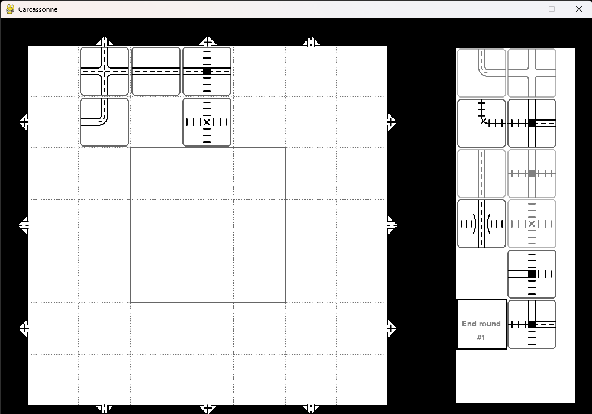

# Railroad Ink — Encre, routes & rails

Projet universitaire réalisé en équipe : une implémentation en Python du jeu de
société **Railroad Ink**, conçue dans le contexte d’un tournoi d’algorithmique.
Le projet s’inspire de l’édition *Deep Blue* et de ses règles officielles. Il
réunit un plateau graphique, la logique des tuiles et des dés, des outils de
calcul de score et une communication par WebSocket avec un réflecteur.



## Principe du jeu

Chaque joueur construit un réseau de routes et de voies ferrées sur une grille
de 7 × 7 cases, à partir des sorties placées sur ses bords. À chaque tour, le
lanceur fournit trois tuiles ordinaires et une tuile de connexion spéciale. Le
joueur choisit où placer les tuiles et comment les orienter afin de relier ses
réseaux et ses sorties.

Le code de calcul des points couvre notamment les sorties reliées, les plus
longs réseaux routier et ferroviaire, les cases centrales et les connexions
incomplètes.

## Fonctionnalités et conception

- **Plateau et tuiles** — représentation des cases, des sorties, des types de
  routes et des tuiles de connexion, avec des vérifications de compatibilité.
- **Interface graphique** — interface interactive en Pygame pour afficher le
  plateau, choisir les tuiles, les orienter et les placer. Les positions
  compatibles peuvent être mises en évidence.
- **Gestion des dés** — lancement de trois dés de routes et rails et d’un dé
  de connexion, puis transmission des résultats aux clients.
- **Clients de jeu** — composants distincts pour le joueur, l’animateur, le
  lanceur de dés, l’historique des messages et l’arbitre.
- **Communication** — client WebSocket et fonctions dédiées aux messages du
  protocole, notamment pour les lancers, les placements, les scores, les
  autorisations et les contestations.
- **Règles et score** — classes dédiées aux règles, à la construction de
  graphes de routes et au calcul des points.

L’architecture sépare ces responsabilités entre les packages `composants`,
`interface`, `clients`, `modules`, `rules` et `game`. Le projet a évolué d’un
prototype centré sur la connexion au réflecteur vers plusieurs versions de
l’application et l’intégration de l’interface.

Pour plus d'informations sur les différentes classes du projet, consultez [projet](railroadInk/projet.md)

## Technologies

- Python
- Pygame CE pour l’interface graphique
- `websocket-client` pour les échanges réseau
- GNU Make pour les commandes de lancement et les tests

## Installation et lancement

Depuis le dossier `railroadInk/`, installer les dépendances dans
l’environnement Python utilisé par `make` :

```bash
python -m pip install -r requirements.txt
```

Le jeu communique avec un réflecteur WebSocket à l’adresse
`ws://localhost:3000`. Il faut démarrer un réflecteur compatible avant de lancer
le jeu :

```bash
make game
```

Le binaire `railroadInk/reflector` fourni dans le dépôt est un exécutable Linux.
Sous Windows, utilisez-le depuis WSL/Linux ou fournissez un réflecteur
compatible accessible sur le même port. Sans serveur actif, la connexion
échoue et les échanges réseau ne sont pas disponibles.

## Tests

Les tests du plateau et du calcul des points peuvent être lancés depuis
`railroadInk/` :

```bash
make test-board
make test-points
```


## Références

- [Railroad Ink: Deep Blue Edition](https://horribleguild.com/eu/product/railroad-ink-deep-blue/)
- [Règles officielles de l’édition Deep Blue](https://www.dropbox.com/scl/fi/i93ybxqc8f8230y0i9puj/RRI_BLUE_Rulebook-FR_Web.pdf?rlkey=vyeh09o5dbxwgfoavdyswg7ci&e=1&st=1llaknu8&dl=0)
