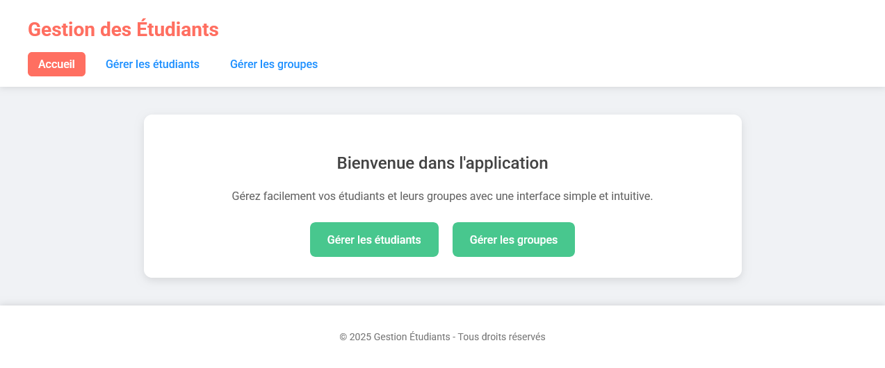
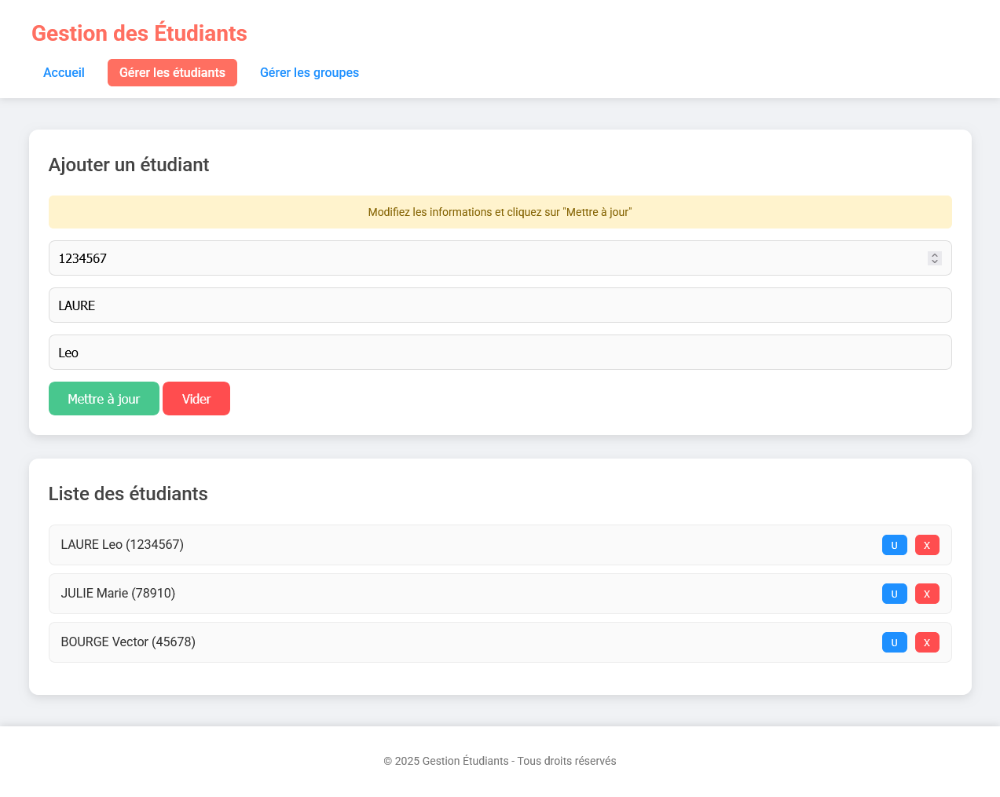
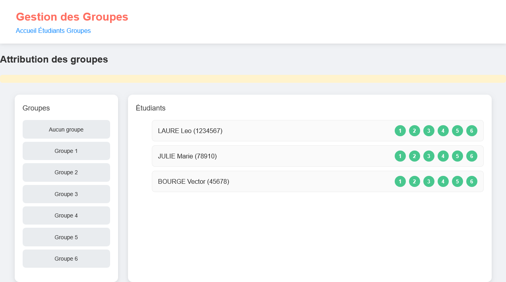

# StudentGroup — Gestion des étudiants et des groupes

Application web de gestion d’étudiants et de leur affectation à des groupes.
L’interface permet de créer, modifier et supprimer des fiches étudiantes,
d’afficher les étudiants non affectés, puis de les assigner ou de les retirer
des groupes numérotés de 1 à 6.

## Captures d’écran

### Accueil



### Gestion des étudiants



### Gestion des groupes



## Fonctionnalités

- Créer des étudiants avec numéro, nom et prénoms.
- Modifier ou supprimer une fiche étudiante.
- Afficher la liste des étudiants et empêcher les doublons de numéros.
- Consulter les étudiants non affectés et les membres d’un groupe.
- Affecter un étudiant à l’un des six groupes ou le retirer de son groupe.
- Valider les données côté serveur et enregistrer les informations dans
  MongoDB.

## Technologies et architecture

- **Frontend :** JavaScript, HTML et CSS, regroupés avec Webpack.
- **Backend :** Node.js et Express, avec une API REST.
- **Base de données :** MongoDB avec Mongoose.

Le dossier `client/` contient les pages, les scripts du navigateur et la
configuration Webpack. La compilation produit les pages et les bundles dans
`server/public/`. Le dossier `server/` contient l’application Express, les
routes et contrôleurs REST ainsi que les modèles Mongoose `Student` et
`Groupe`.

## Prérequis

- Node.js et npm.
- MongoDB installé et la commande `mongod` disponible.

## Installation et lancement

Depuis la racine `StudentGroup/`, ouvrir un terminal pour chaque étape.

1. Créer le dossier de données MongoDB, puis démarrer MongoDB :

   ```bash
   mkdir mongoData
   mongod --dbpath ./mongoData
   ```

   Si le dossier existe déjà, ne pas recréer ce dossier ; relancer directement
   `mongod --dbpath ./mongoData`.

2. Installer les dépendances du frontend et générer les fichiers servis par le
   backend :

   ```bash
   cd client
   npm install
   npm run build
   ```

3. Dans un autre terminal, installer les dépendances du serveur et démarrer
   l’application :

   ```bash
   cd server
   npm install
   npm start
   ```

Le serveur se connecte à la base `gestion_etudiants` sur
`mongodb://localhost:27017/gestion_etudiants` et écoute sur le port `3000` par
défaut. Ouvrir ensuite [http://localhost:3000/](http://localhost:3000/).
Le port peut être remplacé avec la variable d’environnement `PORT`.

## API REST

Les opérations sont disponibles sur les routes suivantes :

| Méthode | Route | Opération |
| --- | --- | --- |
| `GET` | `/students` | Lister les étudiants |
| `POST` | `/students` | Créer un étudiant |
| `PUT` | `/students/:id` | Modifier un étudiant |
| `DELETE` | `/students/:id` | Supprimer un étudiant |
| `GET` | `/groups` | Lister les étudiants sans groupe |
| `GET` | `/groups/:num` | Lister les étudiants du groupe indiqué |
| `POST` | `/groups` | Affecter un étudiant à un groupe |
| `DELETE` | `/groups/:id` | Retirer un étudiant de son groupe |

