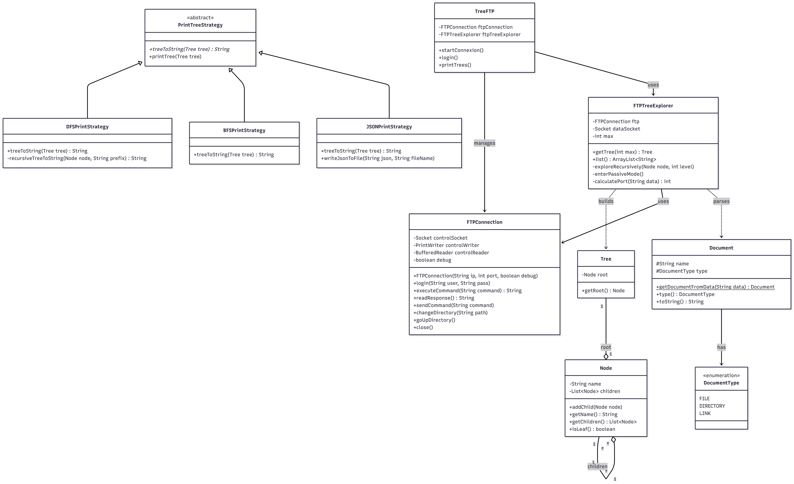

# TreeFTP — Exploration d’arborescence FTP

Application en ligne de commande écrite en Java qui explore l’arborescence d’un serveur FTP et l’affiche dans un format inspiré de la commande Linux `tree`. Le client implémente les échanges FTP avec des sockets TCP, sans bibliothèque cliente FTP.

### Introduction

Le parcours par défaut est en profondeur. L’application peut aussi produire un affichage JSON et un parcours en largeur. Elle prend en charge l’authentification anonyme ou par identifiants fournis en arguments.

### Instructions de build et d’exécution
Prérequis : Java 11 ou une version ultérieure et Apache Maven.

Depuis le dossier du projet, compilez et empaquetez l’application avec Maven :
```bash
mvn clean package
```
Le JAR exécutable est généré ici :
```
target/TreeFtp-1.0-SNAPSHOT.jar
```

Lancez-le en fournissant au minimum l’adresse du serveur FTP :
```bash
java -jar target/TreeFtp-1.0-SNAPSHOT.jar <server> [user] [password] [options]
```
#### Paramètres

| Paramètre | Description | Valeur par défaut |
|---|---|---|
| `server` | Adresse ou nom d’hôte du serveur FTP (obligatoire) | — |
| `user` | Nom d’utilisateur, fourni après le serveur | `anonymous` |
| `password` | Mot de passe, fourni après l’utilisateur | `guest` |
| `--port <port>` | Port FTP | `21` |
| `--depth <max>` | Profondeur maximale d’exploration | Illimitée |
| `--debug` | Affiche les échanges FTP détaillés | Désactivé |
| `--json` | Affiche le résultat JSON et l’écrit dans `output.json`, dans le répertoire courant | Désactivé |
| `--largeur` | Affiche également le résultat en parcours en largeur | Désactivé |

#### Exemples
Connexion anonyme au serveur :
```bash
java -jar target/TreeFtp-1.0-SNAPSHOT.jar ftp.ubuntu.com
```

Connexion à un serveur local sur le port `2121` avec l’accès anonyme :
```bash
java -jar target/TreeFtp-1.0-SNAPSHOT.jar 127.0.0.1 --port 2121
```

Connexion avec des identifiants (remplacez `nom_utilisateur` et `mot_de_passe`), en limitant la profondeur et en activant les sorties JSON, largeur et debug :
```bash
java -jar target/TreeFtp-1.0-SNAPSHOT.jar 127.0.0.1 nom_utilisateur mot_de_passe --port 2121 --depth 2 --json --largeur --debug
```
Les options peuvent être placées après les identifiants.


### Architecture

L'architecture logicielle est conçue autour de la séparation des responsabilités :

- `Interfaces et Classes Abstraites` : La classe abstraite PrintTreeStrategy définit le contrat pour les différents modes de rendu.
- `Polymorphisme` : Les classes DFSPrintStrategy, BFSPrintStrategy et JSONPrintStrategy héritent de la stratégie de base pour transformer l'objet Tree en chaîne de caractères selon des algorithmes distincts.
- `Gestion des données` : La classe FTPTreeExplorer utilise la délégation vers FTPConnection pour les commandes de contrôle et gère la logique d'exploration réseau.
- `Exceptions` : Une hiérarchie d'exceptions (FTPException, LoginException, DataException) assure la propagation des erreurs sans interrompre brutalement le programme.

### Code Samples
1. Initialisation de la connexion

Ce constructeur établit le lien avec le serveur et vérifie immédiatement la disponibilité de ce dernier via le code 220.

````
public FTPConnection(String ip, int port, boolean debug) throws FTPException {
		try {
            controlSocket = new Socket(ip , port);
			
			OutputStream out = controlSocket.getOutputStream();
			controlWriter = new PrintWriter(out, true);
			
			InputStream in = controlSocket.getInputStream();
			InputStreamReader isr = new InputStreamReader(in);
			controlReader = new BufferedReader(isr);

            String welcome = readResponse();
            if (welcome == null || !welcome.startsWith("220")) {
                throw new FTPException("Failed to connect to server: " + welcome);
            }
            if (debug) {
                this.ResponseDebug(welcome);
            }
		} catch (IOException e) {
			throw new FTPException("Cannot open the connexion with the server");
		}
        this.debug = debug;
	}
````
2. Gestion du mode passif

Le calcul du port de données est effectué à partir de la réponse du serveur à la commande PASV.
````
private int calculatePort(String data) {
  // Extraction des paramètres p1 et p2 de la réponse (h1,h2,h3,h4,p1,p2)
  String inside = data.substring(data.indexOf("(") + 1, data.indexOf(")"));
  String[] parts = inside.split(",");
  int p1 = Integer.parseInt(parts[4]);
  int p2 = Integer.parseInt(parts[5]);
  return (p1 * 256) + p2; // Calcul du port selon la RFC 959
}
````
3. Stratégie d'affichage (Pattern Strategy)

Le polymorphisme est utilisé pour varier l'affichage de l'arborescence sans modifier la structure de l'arbre.
````
public abstract class PrintTreeStrategy {
  // Méthode abstraite implémentée par DFS, BFS et JSON
  public abstract String treeToString(Tree tree);

  public void printTree(Tree tree) {
    System.out.println(treeToString(tree));
  }
}
````
4. Parsing des métadonnées de fichiers

Le type de document est identifié par le premier caractère de la ligne renvoyée par la commande LIST.
````aiignore
public static Document getDocumentFromData(String data) {
  DocumentType type;
  switch (data.charAt(0)) { // Analyse du caractère de type UNIX
    case 'd' : type = DocumentType.DIRECTORY; break;
    case 'l' : type = DocumentType.LINK; break;
    default : type = DocumentType.FILE;
  }
  ... // Extraction du nom en fin de ligne
  return new Document(name, type);
}
````

5. Exploration récursive avec sécurité

L'exploration descend dans les répertoires et remonte systématiquement pour maintenir l'état du serveur.
````aiignore
public void exploreRecursively(Node node, int level) throws ... {
  if (this.max != -1 && level >= this.max) return; // Limite de profondeur
  ArrayList<String> files = list(); // Récupération du contenu
  for (String file : files) {
    ... // Création du nœud enfant
    if (doc.type() == DocumentType.DIRECTORY && !isNavigationDir(doc)) {
      ftp.changeDirectory(doc.toString()); // Entrée dans le dossier
      exploreRecursively(child, level + 1);
      ftp.goUpDirectory(); // Remontée au répertoire parent (CDUP)
    }
  }
}
````
### Exemple d’affichage

#### Exemple de débugage
```declarative
Connecting to 127.0.0.1...
> USER bouchra
< 331 Username ok, send password.
> PASS 12345
< 230 Login successful.
Logging in as bouchra...
Login successful. Ready to list tree.
> PASV
< 227 Entering passive mode (127,0,0,1,148,147).
> LIST
< 125 Data connection already open. Transfer starting.
< 226 Transfer complete.
< 250 "/.git" is the current directory.
```

#### Exemple d'affichage pour le parcours en profondeur
```
.
├── pub
│   ├── archive
│   └── ubuntu
└── README

```
#### Exemple d'affichage en JSON
```declarative
[
        {
                "name": ".git",
                "type": "directory",
                "children": [
        {
                "name": "FETCH_HEAD",
                "type": "file"
        },
        {
                "name": "HEAD",
                "type": "file"
        },
...
```

#### Exemple d’affichage pour le parcours en largeur :
```declarative
Niveau 0:
Dossier: ".git" | Fichier: ".gitignore" | Fichier: "README.md" | Fichier: "pom.xml" | Fichier: "sr1_tp1_bouamama_bouchra.iml" | Dossier: "src" | Dossier: "target"
Niveau 1:
Fichier: "FETCH_HEAD" | Fichier: "HEAD" | Fichier: "ORIG_HEAD" | Fichier: "config" | Fichier: "description" | Fichier: "hooks" | Fichier: "index" | Fichier: "info"
```

### Fonctionnalités implémentées

- Connexion à un serveur FTP distant via sockets TCP
- Authentification avec :
  - utilisateur / mot de passe
  - ou accès anonyme par défaut

- Utilisation des commandes FTP suivantes :
  - USER
  - PASS
  - PASV
  - LIST
  - CWD
  - CDUP

- Exploration récursive de l’arborescence distante (parcours en profondeur et en largeur)
- Identification des types de documents :
  - fichiers
  - répertoires
  - liens symboliques
- Construction d’une structure arborescente interne (Tree, Node)
- Affichage de l’arborescence sur la sortie standard au format souhaité
- Limitation de la profondeur d’exploration
- Gestion des erreurs FTP et réseau via exceptions personnalisées
- Mode debug optionnel

#### Diagramme de classes UML
