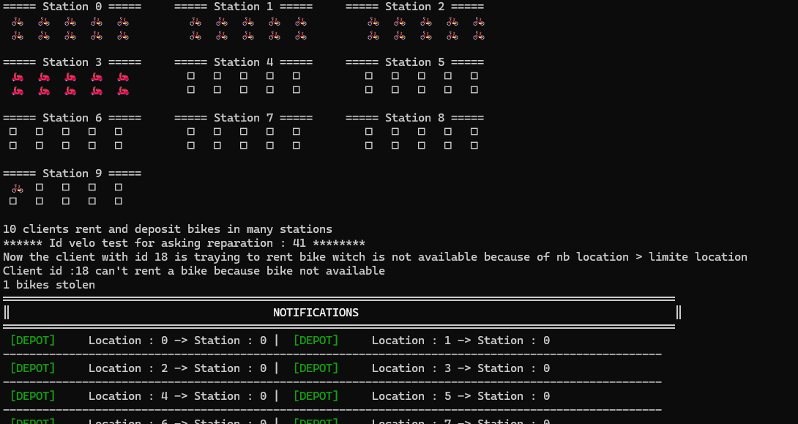
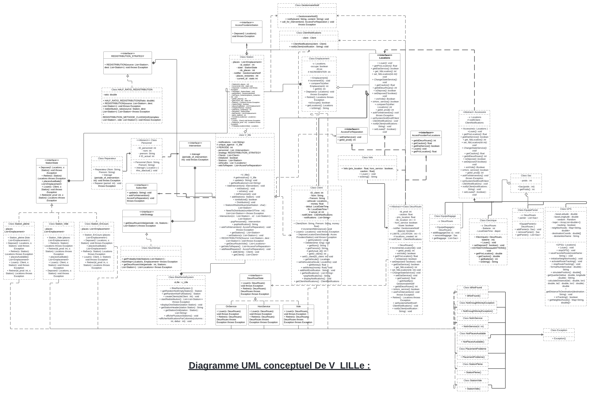

# V'Lille — Simulation de vélos en libre-service

# Présentation du projet:

Le projet "Vélos Libre Service" consiste à concevoir une simulation d'un système de location de vélos en libre service, similaire à Vélib ou V'Lille. Le système comprend des stations de location où les vélos peuvent être déposés et retirés. Les vélos peuvent être classiques ou à assistance électrique, équipés ou non d'accessoires tels qu'un panier ou des porte-bagages. Un centre de contrôle supervise l'ensemble de la flotte de vélos et des stations, et est notifié à chaque dépôt/retrait de vélo. Il est également responsable de la redistribution des vélos dans les stations lorsqu'une ou plusieurs stations restent vides ou pleines pendant une période prolongée.




## Fonctionnalités modélisées

- Stations avec emplacements permettant de déposer ou louer un vélo.
- Deux-roues à différents états de service, dont les vélos électriques.
- Clients, locations et accessoires ajoutés aux vélos (panier, bagage et GPS).
- Notifications lors des événements importants et demandes d’intervention.
- Détection des vélos potentiellement volés selon une stratégie configurable.
- Redistribution des vélos entre stations pleines et vides par une stratégie dédiée.
- Scénario de démonstration exécuté depuis la classe `main`, avec affichage de l’état des stations, des notifications et de la redistribution.


## Technologies

- Java 11 ou supérieur (le projet a été compilé et testé avec un JDK plus
  récent).
- GNU Make et un shell POSIX (`/bin/sh`, par exemple MSYS2 ou Git Bash sous
  Windows).
- JUnit 5 pour les tests, fourni dans le dossier `lib/`.

## Compiler, tester et exécuter

Exécuter les commandes suivantes depuis la racine du projet, dans laquelle se
trouvent `Makefile`, `pom.xml` et `src/`.

Compiler les sources :

```bash
make compile
```

Compiler et lancer tous les tests :

```bash
make test
```

Lancer un test précis :

```bash
make run-test TEST_CLASS=fil.l3.coo.ClientTest
```

Exécuter la simulation :

```bash
make run
```

Générer la documentation Javadoc dans `doc/` :

```bash
make doc
```

Construire puis exécuter le fichier JAR :

```bash
make jar
make run-jar
```

`make all` enchaîne compilation, tests, génération de la documentation,
création du JAR et exécution de la simulation (`run-jar`). Il lance donc le
programme ; pour compiler sans l’exécuter, utiliser `make compile`.

Pour supprimer les fichiers générés :

```bash
make clean
```


# WHY THOSE PATTERNS
Dans ce projet, afin d'assurer la flexibilité et la robustesse du code, nous avons adopté plusieurs Design Patterns et principes de conception. Voici un aperçu des principaux patterns utilisés :

## A- DESIGN PATTERNS :
## Pattern Decorateur : 
````
Le Pattern Décorateur a été utilisé pour définir des wrappers permettant d'accessoiriser les objets de type "Deux Roues". Nous avons conçu une classe Accessoire, qui agit comme une abstraction commune pour tous les wrappers. Cette classe facilite la factorisation des méthodes et attributs communs (notamment la référence à l'objet décoré V), tout en permettant l'ajout dynamique de nouvelles fonctionnalités.
````

## Pattern Singlotent :
```` 
Nous avons implémenté un Pattern Singleton pour garantir l'existence d'un seul et unique centre de contrôle, V_Lille. Ce dernier centralise la gestion du réseau et reçoit les notifications de tous les événements importants, offrant ainsi un point de coordination unique.
````

## Pattern Observateur :
```` 
Pour gérer efficacement les notifications, nous avons utilisé le Pattern Observateur. Dans cette architecture :
- V_Lille joue le rôle de subscriber.
- Les objets tels que les vélos, les stations, et les interventions de personnel agissent comme des publishers. Cela permet à  V_Lille d'être informé en temps réel de tout changement dans le réseau.
````
## Pattern State :
Certains objets du projet possèdent plusieurs états, chacun avec un comportement spécifique. Le Pattern State permet de gérer cette complexité de manière structurée.
### CLASSE STATION : 
````
      *  Une station peut être dans des états tels que pleine ou vide, influençant directement la possibilité de déposer ou retirer un vélo.
      *  D'autres états peuvent être ajoutés, comme en maintenance.
````
### CLASSE DEUX ROUES : 
````
       Un vélo peut avoir plusieurs états tels que volé, hors service, ou en service. Le Pattern State facilite l'association de comportements distincts à chaque état.
````
## Pattern Strategy :
Dans le cahier de charge  , on y distingue deux principaux type de stratégies :
### Strategie de Redistribution :
    Dans notre projet , nous avons opté pour la HALF_RATION_REDISTRIBUTION , je developpe :
    ````  
        *   Après deux périodes de temps, les stations pleines et vides sont identifiées.
        *   50% des vélos des stations pleines sont redistribués séquentiellement vers les stations vides.
    ````
D'autres stratégies peuvent être ajoutées ultérieurement pour répondre à des besoins spécifiques.

### Strategie de VOL :
- **Nous avons opté pour la règle suivante**: un vélo laissé seul en station pendant deux périodes de temps est considéré comme potentiellement volé.
- Une autre stratégie possible serait de détecter un vélo volé en fonction du temps écoulé depuis sa dernière location.


## B- PATRONS SOLIDE : 
### OCP : 
````
Le code est ouvert aux extensions et fermé aux modifications. Par exemple :
- - De nouveaux états peuvent être ajoutés pour les vélos.
- - nouvelles stratégies de redistribution ou de détection de vol peuvent être introduites sans modifier le code existant.
````

### LSP :
````
Chaque sous-classe peut remplacer sa classe parente sans altérer le comportement du système :
- - Un objet Vélo peut remplacer un objet Deux Roues.
- - Un accessoire électrique peut remplacer un accessoire standard.
````
### SRP : 
````
Chaque classe et méthode a une responsabilité unique :
- - Les classes sont conçues pour répondre à un besoin spécifique.
- - Les méthodes remplissent une seule fonction clairement définie.
````

### DIP :
````
    - Dans le projet toutes les classes dependent des interfaces ou classe absraite ( Locations, Deux Roues , Accessoire )
````
### ISP : 

Dans le projet , ce principe est donne sous le Titre **Access Controller**   ; en effet , on peut limiter l'acces d'un objet A vers un objet B passé en Parametre dans l'une des methode de A , en se limitant que sur ce dont l'objet A en a besoin , ceci en implementant des interfaces , qui limite un comportement precis reduit aux besoin de A de B , les interfaces en question se trouvent donc dans le Dossier **AccessController** 

Le code Java est organisé sous `src/main/java/fil/l3/coo/`, avec des packages
séparés pour les décorateurs, les états, les stratégies, les notifications,
les exceptions et les interfaces d’accès. Les tests JUnit 5 se trouvent sous
`src/test/java/fil/l3/coo/`.


## Diagramme UML

[Ouvrir le diagramme UML dans Lucidchart](https://lucid.app/lucidchart/cd7cdf00-6700-4a08-9660-d92b12dc9364/edit?view_items=3yehJifyM34x&invitationId=inv_da613a3c-7b30-4886-8aa2-2c8b3ad06817)




