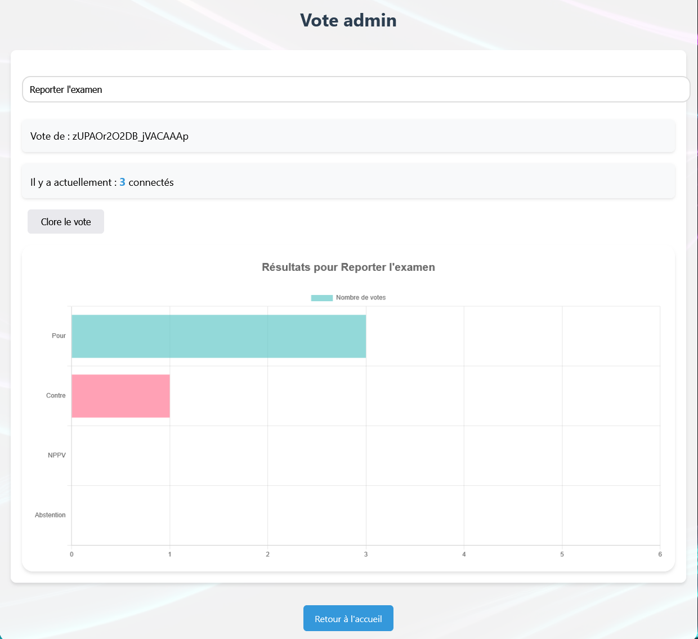
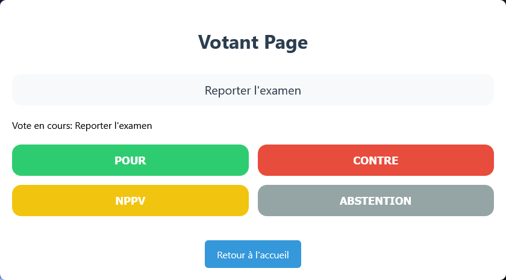
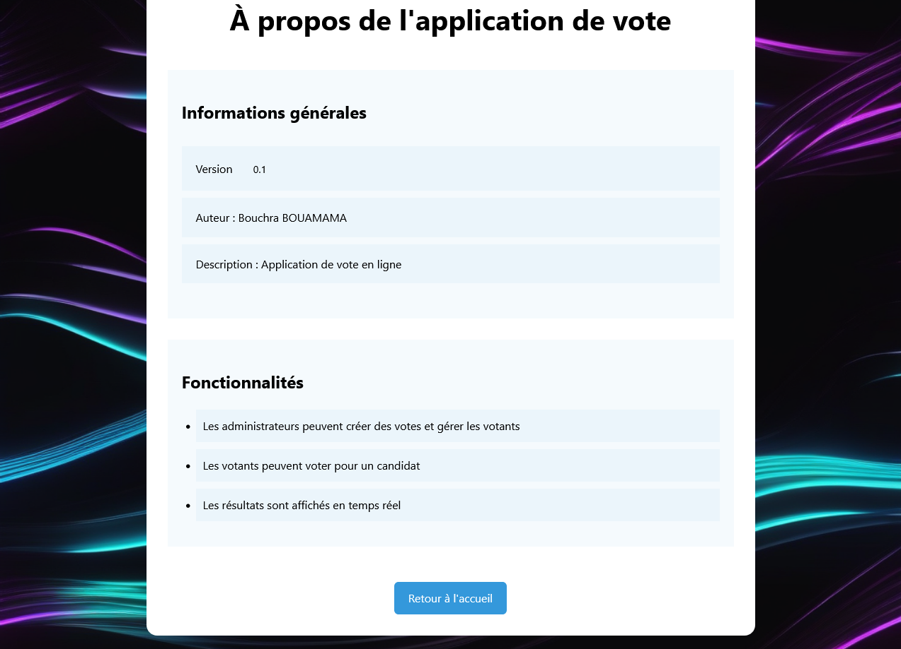

# VoteApp — Application de vote en ligne

VoteApp est une application web de vote en temps réel. Elle propose une
interface d’administration pour lancer et clore un scrutin, ainsi qu’une
interface de participation où les votants choisissent une réponse. Les résultats
sont actualisés en direct côté administration et présentés aux participants à
la clôture du vote.


## Interfaces

### Administration



L’administration permet de définir le sujet du scrutin, d’ouvrir ou de clore
le vote, de suivre le nombre de connexions et de votants, et de visualiser les
résultats en direct. Une seule connexion peut occuper le rôle d’administrateur
à la fois.

### Participation



Les choix proposés sont **Pour**, **Contre**, **NPPV** et **Abstention**. Un
participant peut remplacer son choix tant que le scrutin est ouvert.
À la clôture, les résultats sont affichés sous forme de graphique.

### À propos



## Fonctionnement

Le serveur Node.js sert les pages et ressources web, et utilise Socket.IO pour
diffuser les événements de connexion et de vote en temps réel. Les choix sont
comptabilisés en mémoire par connexion : l’application n’utilise pas de base de
données pour conserver les scrutins. Le redémarrage du serveur réinitialise
l’état du vote.

Le premier client qui demande le rôle administrateur l’obtient ; les autres
demandes sont refusées tant que cette connexion est active. Cette attribution
n’est pas une authentification : ne déployez pas l’application sur un réseau
public sans ajouter un contrôle d’accès approprié.

## Technologies

- JavaScript côté navigateur et côté serveur (Node.js).
- Socket.IO pour la communication bidirectionnelle en temps réel.
- Webpack et Babel pour construire les scripts frontend.
- Chart.js pour les graphiques de résultats.
- HTML et CSS pour les pages et leur présentation.

## Prérequis

- Node.js et npm.

## Installation et lancement

Ouvrir un terminal dans le dossier `vote/` du projet, puis installer les
dépendances :

```bash
npm install
```

Construire les pages et les bundles frontend dans `server/public/` :

```bash
npm run build
```

Démarrer le serveur depuis le même dossier :

```bash
node server/index.js
```

Ouvrir ensuite les pages suivantes :

| Page | Adresse |
| --- | --- |
| Accueil | [http://localhost:8080/](http://localhost:8080/) |
| Administration | [http://localhost:8080/admin-vote](http://localhost:8080/admin-vote) |
| Participation | [http://localhost:8080/votant](http://localhost:8080/votant) |
| À propos | [http://localhost:8080/about](http://localhost:8080/about) |

Le serveur écoute sur le port `8080`, configuré dans `server/index.js`.
L’application attend que le bundle frontend ait été généré avant son
utilisation.

## Structure du projet

```text
VoteApp/
├── Accueil.png, Admin.png, Votant.png, A_propos.png
└── vote/
    ├── client/
    │   ├── admin-vote/       # Interface et logique d'administration
    │   ├── votant/           # Interface et logique des participants
    │   ├── shared/           # Configuration des graphiques
    │   ├── html/             # Pages source
    │   └── style/            # Styles CSS
    ├── server/
    │   ├── public/           # Pages et bundles servis
    │   ├── index.js          # Serveur HTTP et Socket.IO
    │   ├── ioController.js   # Connexions, scrutins et votes
    │   └── requestController.js # Routage et service des fichiers
    ├── package.json
    └── webpack.config.js
```

