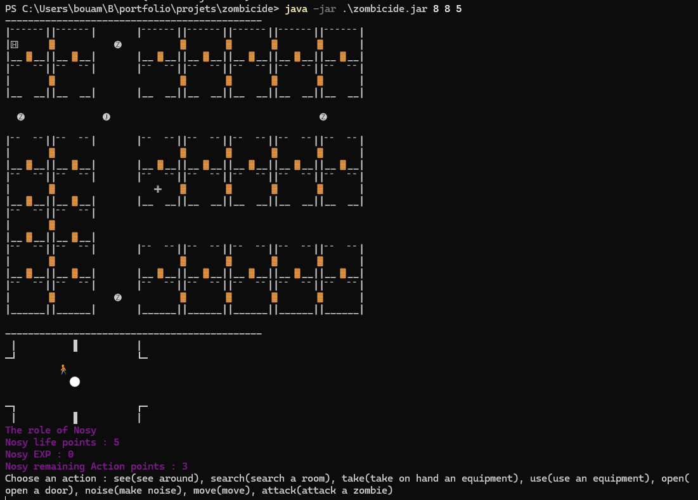

# Zombicide — Jeu de survie en Java

Projet universitaire de programmation orientée objet : une adaptation en
console d’un jeu coopératif de survie face à des zombies. Les joueurs explorent une ville générée aléatoirement, fouillent les bâtiments, récupèrent de l’équipement et affrontent des zombies qui arrivent par les égouts.



## Fonctionnalités

- Génération d’un plateau de ville paramétrable, composé de rues, bâtiments,
  portes et égouts, avec une pharmacie et un hôtel.
- Création d’un ou plusieurs survivants avec un rôle parmi Nosy, Fighter,
  Healer et Lucky.
- Tour par tour interactif dans le terminal : observer sa case, fouiller une
  pièce, ramasser ou utiliser un équipement, ouvrir une porte, se déplacer,
  faire du bruit ou attaquer.
- Gestion de l’équipement : armes, objets de soin, carte, lunettes et clés.
- Plusieurs types de zombies — Walker, Runner, Strong et Abomination — avec
  des caractéristiques différentes.
- Phase des zombies : attaque des survivants présents sur leur case ou
  déplacement vers une source de bruit, puis arrivée de nouveaux zombies par
  les égouts.
- Conditions de victoire et de défaite, ainsi qu’affichage de l’état du
  plateau et des survivants.

## Technologies et conception

- **Java** — code source organisé en classes dédiées au plateau, aux cases, aux
  joueurs, aux zombies, aux équipements et aux actions.
- **GNU Make** — automatisation de la compilation, de la documentation
  Javadoc, de la création du JAR et du lancement.
- **JUnit** — plusieurs classes de tests sont présentes dans `tests/`.

Le projet met notamment en pratique les interfaces de rôles et d’actions,
l’héritage pour les éléments du plateau et les équipements, ainsi que la
séparation des actions du joueur en composants distincts. Le diagramme UML est
disponible dans [uml/UML.png](uml/UML.png).

## Prérequis

- Un JDK installé (`javac` et `java`).
- GNU Make et un shell compatible avec les commandes POSIX, par exemple Bash,
  Git Bash ou MSYS2.

## Compiler et lancer

Depuis la racine du projet, compiler les sources dans le dossier `cls/` et
lancer une partie avec une ville de 10 × 14 cases et quatre survivants :

```bash
mkdir -p cls
javac -g -d cls $(find src -name "*.java")
java -cp cls GameMain 10 14 4
```

Les dimensions doivent être au moins égales à 5 et le nombre de joueurs doit
être positif. Le scénario est piloté par les entrées saisies dans le terminal.

### Actions en jeu

Au début d’un tour, le jeu affiche les actions disponibles. Saisir l’une des
commandes proposées :

| Commande | Action |
| --- | --- |
| `see` | Afficher la case et ses éléments |
| `search` | Fouiller la pièce courante |
| `take` | Équiper un objet depuis le sac |
| `use` | Utiliser l’objet tenu en main |
| `open` | Ouvrir une porte, avec un équipement adapté |
| `noise` | Produire du bruit sur la case |
| `move` | Se déplacer ; saisir ensuite `up`, `down`, `left` ou `right` |
| `attack` | Attaquer un zombie à portée |
| `heal` | Soigner un survivant (rôle Healer uniquement) |

La partie se termine lorsque les survivants éliminent les zombies ou atteignent
le niveau d’expérience collectif requis, ou lorsque tous les survivants sont
éliminés.

## Organisation des fichiers

```text
zombicide/
├── src/
│   ├── Actions/       # Déplacement, attaque, fouille, équipement et bruit
│   ├── Board/         # Génération et affichage de la ville
│   ├── Cells/         # Rues, pièces, bâtiments, portes et égouts
│   ├── Equipments/    # Armes et objets
│   ├── Players/       # Survivants, rôles et zombies
│   ├── Game.java      # Boucle et règles de la partie
│   └── GameMain.java  # Point d’entrée
├── tests/             # Tests unitaires
├── uml/               # Diagrammes UML
├── Makefile
└── README.md
```

## Tests

Des tests unitaires sont présents sous `tests/`. La cible `test` du Makefile
fait référence à des chemins et à un fichier JUnit Console qui ne sont pas
fournis à ces emplacements dans le dépôt ; elle nécessite donc une mise à jour
ou une configuration JUnit adaptée avant de pouvoir être utilisée telle
quelle.
